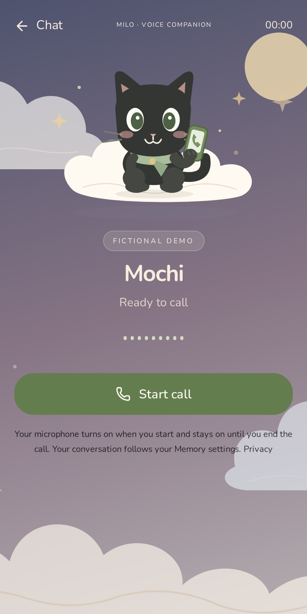
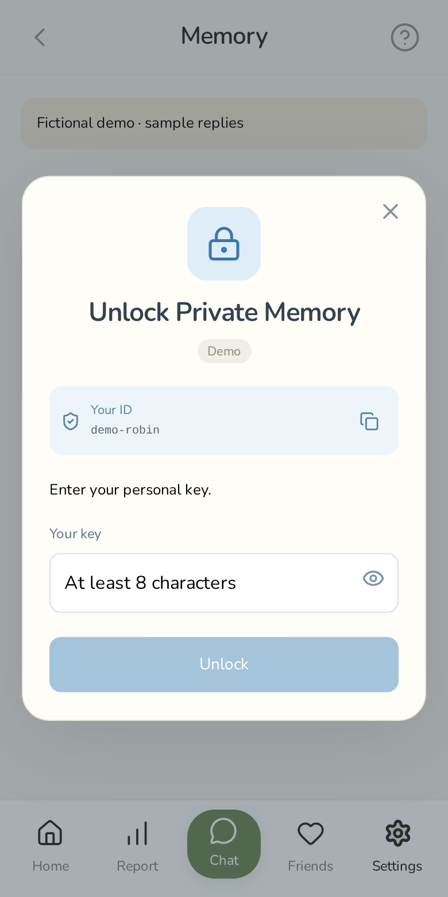
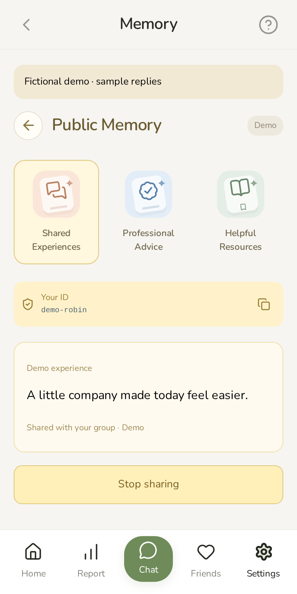

# Milo — A Voice Companion for Eating Disorder Support

Milo is a voice-first AI cat companion for adults navigating eating disorders. Call Milo for emotional support before or after a difficult meal, choose what it remembers privately, or explore the Public Memory preview.

| Voice call | Private Memory | Public Memory |
| :---: | :---: | :---: |
| [](docs/screenshots/voice-call.png) | [](docs/screenshots/private-memory.png) | [](docs/screenshots/public-memory.png) |

*Mobile interface previews with fictional data. Select a screenshot to view it at full size.*

## Talk with Milo

Some days it’s easier to speak than to type. Start a voice call and tell Milo what kind of company you want. You might say, *“Dinner was hard today. Can you just listen for a minute?”* Milo responds aloud in your cat’s voice. You can read captions, mute your microphone, interrupt a reply, or end the call whenever you want.

## Private Memory

Talking about eating or mental health can mean sharing something you would only say in private. Milo’s private memory database keeps selected details tied to your account. With memory enabled, you can tell Milo, *“After dinner, please listen first and keep your replies short.”* If Milo saves that preference, it can use it the next time you call.

You can see what Milo has remembered, correct a detail, delete it, or turn memory off. For a conversation you want to keep out of Milo’s chat history and long-term memory, choose a temporary chat. Live calls still use the configured AI and speech providers, which may retain requests under their own policies.

## Public Memory

Public Memory is a separate space for **Shared Experiences**, **Professional Advice**, and **Helpful Resources**. The prototype uses a fictional experience to demonstrate sharing. The advice and resource sections are previews. Personal calls and entries in the private memory database stay out of this public space. [How the memory preview works](docs/MEMORY-PREVIEW.md)

## Between calls

- **Meal and mood journal.** Save a photo, a feeling, or a few words about a meal. Weekly and monthly reports summarize the moments you recorded.
- **Eat Together.** Share a meal with your animated cat or invite friends to a private video room.
- **Make Milo yours.** Choose a black or white cat, give it a name, and set its language and conversation style.

Built for Cal Hacks 13.0, Milo is a mobile-first prototype for everyday emotional companionship. Diagnosis, treatment, and emergency care are outside its scope.

## Try it

Choose **Try the fictional demo** on the login screen to explore with sample data. To hear Milo’s live voice, sign in to an account with the voice services configured, open Chat, and start a call. Persistent private memory also requires the memory service and its background worker.

## Run locally

Requirements: **Node.js 22+** and **npm**. Python and Docker are needed only for the additional services described below.

```bash
npm ci
cp .env.example .env.local
npm run dev
```

Open **http://localhost:3000** and choose **Try the fictional demo**. Keep `DEMO_ENABLED=true` and `APP_ORIGIN=http://localhost:3000` for this local preview. Do not enter real personal or health information in the fictional demo.

To build and serve the production bundle:

```bash
npm run build
npm start
```

A build does not provision external services. If the browser uses a different origin, update `APP_ORIGIN` to that exact origin.

## Configure live services

Use `.env.example` as the configuration reference. Set credentials in `.env.local` or your hosting provider's secret manager.

| Service | Purpose | Main configuration |
| --- | --- | --- |
| **Supabase** | Authentication and private application records | `NEXT_PUBLIC_SUPABASE_URL`, `NEXT_PUBLIC_SUPABASE_ANON_KEY` |
| **Anthropic Claude** | Contextual conversation, plans, and memory extraction | `ANTHROPIC_API_KEY` and the model variables in `.env.example` |
| **Cartesia** | Character speech and optional English realtime transcription | `CARTESIA_API_KEY`, character voice IDs; optional `VOICE_REALTIME_STT=true` |
| **Local faster-whisper** | Local transcription when that recognition path is used | Python dependencies and `npm run speech` |
| **Mem0 OSS + Qdrant** | Long-term memory service and persistence | `MEMORY_SERVICE_URL`, `MEMORY_SERVICE_TOKEN`, Docker Compose |
| **Background worker** | Memory and deletion jobs | `npm run worker`, server-only `SUPABASE_SERVICE_ROLE_KEY` |
| **Daily** | Private friend video rooms | Server-only `DAILY_API_KEY` |

### Authentication and storage

1. Create a Supabase project and apply `supabase/migrations/001_haven.sql`.
2. Configure email/password authentication and email delivery. Keep email confirmation enabled.
3. Use `supabase/templates/confirmation.html` for the signup email template, including its `{{ .Token }}` placeholder.
4. Set the Supabase Site URL to `APP_ORIGIN`. Allow the appropriate `/auth/callback` and `/auth/callback?next=/reset-password` redirect URLs.
5. Configure the required live services, then set `DEMO_ENABLED=false` for a live-user deployment.

The public Supabase project values are distinct from the server-only administrative key. Never expose the service-role key to browser code.

### Voice and memory processes

For local transcription:

```bash
python3 -m pip install -r services/speech/requirements.txt
npm run speech
```

For persistent memory:

```bash
docker compose up --build -d
npm run worker
```

Run these alongside the Next.js server in separate terminals or supervised processes. The first speech startup may download model weights. English realtime recognition is an optional alternative; see the voice documentation for configuration.

Voice calls require microphone permission and HTTPS or localhost. Replies are generated contextually; legacy prerecorded conversational replies are retired. Interruption uses an explicit control rather than full-duplex acoustic barge-in. Camera and microphone start off when joining a friend video room.

## Architecture

```text
Next.js / React mobile web interface
             |
      Next.js API routes
       /      |       \
Supabase   Claude    Daily video rooms
              |
       Cartesia speech

Voice input → realtime transcription or local faster-whisper
Memory jobs → background worker → internal Mem0 OSS → Qdrant
```

The project uses TypeScript, Next.js App Router, React, Tailwind CSS, Lucide, Supabase, Anthropic, Cartesia, Daily, and an internal Python memory adapter.

## Project structure

```text
src/app/              Routes, API handlers, and styles
src/components/       Companion, chat, voice, reports, and friend interfaces
src/lib/              Models, validation, prompts, services, and session logic
public/               Static artwork, icons, fonts, and app manifest
services/memory/      Internal Mem0 OSS adapter
services/speech/      Local speech recognition service
supabase/             Database migration and email template
scripts/              Workers, service checks, and verification tools
tests/                Automated tests
docs/                 Technical setup and feature documentation
```

## Validation

```bash
npm run typecheck
npm run lint
npm test
npm run build
```

Additional checks are available for configured environments:

```bash
npm run verify:services
npm run verify:voice
npm run verify:personalization
npm run verify:journal
npm run verify:friends
```

Read the relevant scripts before running live verification: some create test accounts, require administrative credentials, or call paid services. Passing local tests does not establish production readiness or real-device audio/video reliability.

## Privacy and limitations

- Application records are scoped to authenticated users. Memory behavior depends on the selected mode and source permissions.
- Live conversations and speech may be processed by configured AI and speech providers. This prototype does not promise end-to-end encryption or zero provider retention.
- Memory is asynchronous and selective. An empty result is valid, and background service failures must be resolved separately.
- The cat's mouth animation indicates speech; it is not phoneme-accurate lip synchronization.
- Friend video uses browser media capabilities. Camera switching depends on available hardware; the sound control does not guarantee native phone earpiece routing.
- A minimized meal call stays mounted on the current page. Navigating away may end the session; native background calling is not implemented.
- Production deployment requires HTTPS, correct origins and redirects, persistent storage, and separately hosted workers and speech/memory services. A Next.js deployment alone is insufficient for every feature.
- Fictional demo storage is local to a single Next.js process and is not a production authentication or database substitute.

## Documentation

- [Voice calls](docs/VOICE_CALL.md)
- [Mobile interface](docs/MOBILE_APP.md)
- [Friends and shared meals](docs/FRIENDS.md)
- [Claude setup](docs/CLAUDE_SETUP.md)
- [Architecture](docs/ARCHITECTURE.md)
- [API reference](docs/API.md)
- [Verification notes](docs/VERIFICATION.md)
- [Historical development notes](docs/DEVELOPMENT_NOTES.md)

Some detailed documents retain historical implementation notes. Current behavior is determined by the source and the current-behavior notices in those documents.

## Source access and attribution

This README does not grant an open-source license to the project. Source access and reuse permissions are controlled separately by the project owners. Third-party packages and assets retain their own licenses; the bundled Nunito font license is in `public/fonts/OFL.txt`.

The interface uses original project artwork and common mobile interaction patterns. UI references do not imply affiliation with WeChat, Tencent, or any other referenced product.
